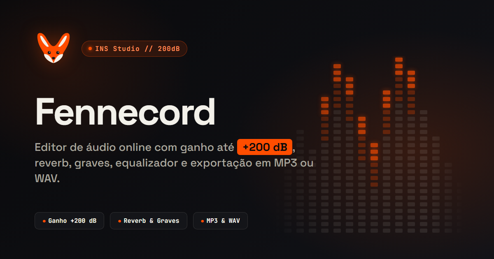
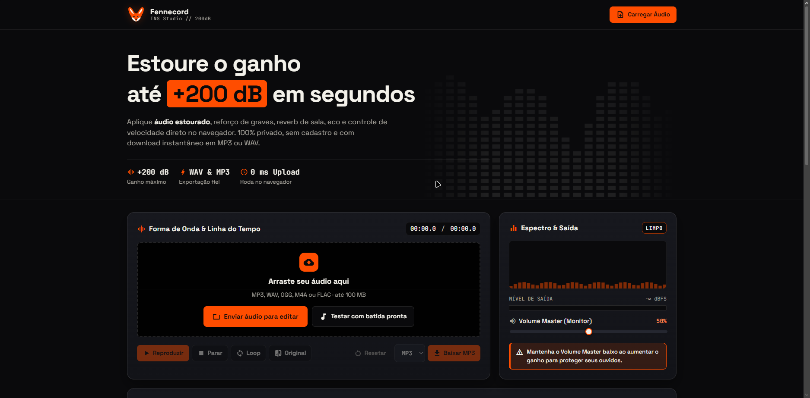
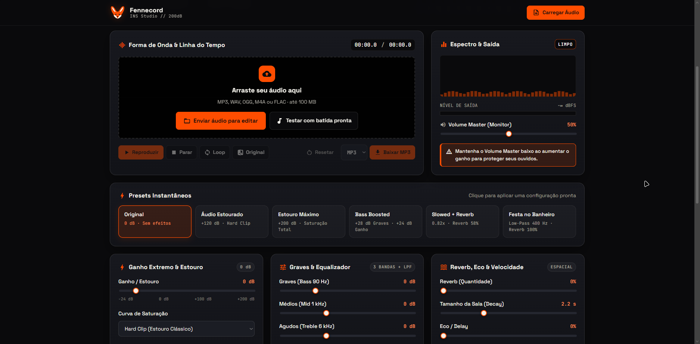
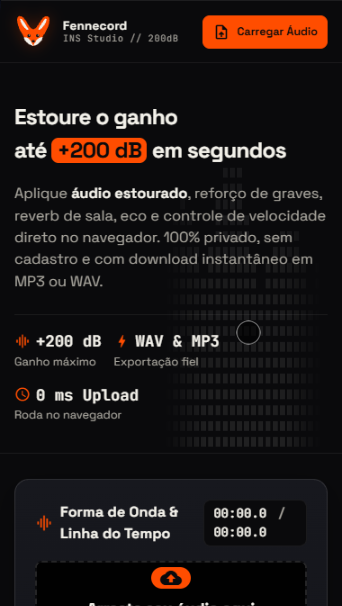

<p align="center">
  
</p>

# Fennecord | INS Studio

Editor de áudio online simples, direto e gratuito para aplicar **ganho extremo até +200 dB (áudio estourado)**, reforço de graves, reverb convolucional, eco/delay, equalização em 3 bandas, filtro abafado e controle de velocidade. Todo o processamento acontece **100% no navegador** via Web Audio API, sem enviar arquivos para servidores externos.

---

## Capturas de tela

### Página inicial e estúdio (Desktop)


### Mesa de efeitos e visualizadores (Desktop)


### Versão responsiva (Mobile)


---

## Funcionalidades implementadas

- **Upload local com validação:** suporte a arrastar e soltar (*drag & drop*) direto na Forma de Onda ou seleção manual para `.mp3`, `.wav`, `.ogg`, `.m4a`, `.flac` e `.webm` (limite de 100 MB), além de um **áudio de teste sintetizado em memória** (batida 120 BPM) para testar o editor sem precisar enviar arquivo.
- **Ganho extremo e saturação (-24 dB a +200 dB):** três curvas de `WaveShaperNode` (*Hard Clip*, *Fuzz Digital* e *Soft Overdrive*), controle de intensidade da distorção e **Volume Master (Monitor)** separado com aviso permanente de proteção auditiva.
- **Graves e Equalizador:** controle de Graves (`90 Hz`, de `-12 dB` a `+36 dB`), Médios (`1 kHz`), Agudos (`6 kHz`) e filtro *Low-Pass* (`400 Hz` a `20 kHz`) para efeito abafado.
- **Reverb, Eco e Velocidade:** reverb convolucional estéreo com resposta ao impulso sintética (`0.5 s` a `6.0 s`), eco/delay com feedback controlado e ajuste de velocidade/pitch (`0.50x` a `2.00x`).
- **Presets instantâneos:** *Original*, *Áudio Estourado (+120 dB)*, *Estouro Máximo (+200 dB)*, *Bass Boosted*, *Slowed + Reverb* e *Festa no Banheiro*.
- **Visualizadores em tempo real:** forma de onda interativa em Canvas com *seek* por clique/arraste, analisador de espectro FFT, medidor VU em dBFS e indicador de status (`LIMPO`, `SATURADO`, `ESTOURADO`).
- **Comparação e atalhos:** botão **Original (Bypass)** (`B`), repetição em **Loop** (`L`), Play/Pause (`Espaço`) e Parar (`R`).
- **Exportação em MP3 e WAV:** renderização offline via `OfflineAudioContext` passando exatamente pela mesma cadeia DSP, com codificação nativa no navegador em **MP3 (192 kbps)** ou **WAV (PCM 16-bit estéreo)**.
- **Privacidade e segurança:** processamento 100% client-side, Content Security Policy (CSP) restritiva sem scripts inline, `Referrer-Policy: no-referrer`, cabeçalhos HTTP de segurança no servidor local e modal transparente de **Privacidade & LGPD**.

---

## Tecnologias utilizadas

| Camada | Tecnologia | Finalidade |
|---|---|---|
| Marcação | HTML5 semântico | Estrutura em grid 12 colunas, acessibilidade e meta tags Open Graph |
| Estilos | CSS3 puro | Paleta Estúdio Hardware (`#0A0A0C`, `#141519`, `#FF4D00`, `#F3F1EA`), responsividade e tipografia cinética |
| Áudio e DSP | Web Audio API | Cadeia de efeitos em tempo real e renderização `OfflineAudioContext` |
| Exportação | `@breezystack/lamejs` e PCM nativo | Codificação local de `AudioBuffer` para MP3 (192 kbps) e WAV (16-bit) |
| Tipografia e Ícones | Google Fonts (`Space Grotesk`, `JetBrains Mono`, `Material Icons`) | Leitura técnica e ícones exclusivamente Material UI |
| Ambiente de Dev / Build | Vite `^6.3.5` | Servidor local rápido (`npm run dev`) e empacotamento (`npm run build`) |

---

## Instalação e execução

Este projeto não exige banco de dados, variáveis de ambiente ou chaves de API.

### Pré-requisitos
- **Node.js** (versão 18 ou superior)
- **npm** (instalado junto com o Node.js)

### Passos

1. Instale as dependências:
   ```bash
   npm install
   ```

2. Inicie o ambiente de desenvolvimento (comando padrão):
   ```bash
   npm run dev
   ```

3. Acesse a aplicação no navegador em:
   ```text
   http://localhost:5173/
   ```

### Outros scripts disponíveis no `package.json`

- `npm run build`: gera a versão otimizada de produção.
- `npm run preview`: inicia uma pré-visualização local do build de produção na porta `4173`.

---

## Privacidade e segurança

- Nenhum arquivo de áudio é enviado a servidores externos: todo o processamento ocorre localmente na memória do navegador.
- Não há cadastro, cookies de rastreamento ou ferramentas de analytics.
- Os únicos recursos carregados externamente são as fontes e ícones oficiais via HTTPS (`fonts.googleapis.com` e `fonts.gstatic.com`), sob `Referrer-Policy: no-referrer` e Content Security Policy restritiva.
- Em ambiente de produção (Vercel, Cloudflare Pages, Netlify ou Nginx), recomenda-se replicar os cabeçalhos HTTP de segurança (`X-Content-Type-Options`, `X-Frame-Options`, `Referrer-Policy` e `Permissions-Policy`).
